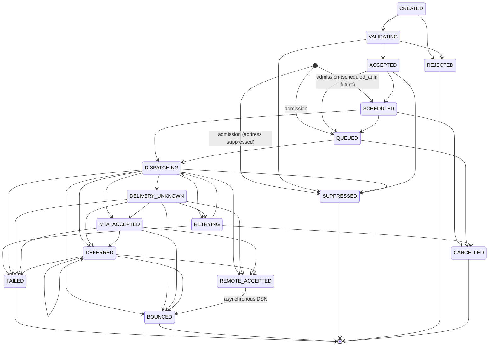

# Message lifecycle

Delivery state is tracked **per recipient** (`email_recipients.state`), because one email to five addresses can have five different outcomes. The state machine is defined in `packages/mail-protocol/src/state-machine.ts` (`TRANSITIONS`) and enforced by `transitionRecipient` in `packages/core/src/transitions.ts`.

Engagement (opens, clicks) and complaints are not part of this machine; they would be separate events. Neither is implemented yet.

## State diagram



`CREATED`, `VALIDATING`, `ACCEPTED` and `REJECTED` exist in the enum and transition table, but admission currently validates the whole request before writing anything. Recipients are therefore inserted directly as `QUEUED`, `SCHEDULED` or `SUPPRESSED`; an invalid request is refused with a 4xx and no rows are written.

## Terminal and settled states

| Set | States | Meaning |
| --- | --- | --- |
| `TERMINAL_STATES` | `FAILED`, `BOUNCED`, `SUPPRESSED`, `REJECTED`, `CANCELLED` | No outgoing transitions. |
| `SETTLED_STATES` | terminal + `REMOTE_ACCEPTED` | Transport is finished. `REMOTE_ACCEPTED` may still become `BOUNCED` if the receiver later sends a DSN. |
| `DISPATCHABLE_STATES` | `QUEUED`, `SCHEDULED`, `RETRYING` | The only states the dispatcher may claim. |

`DELIVERY_UNKNOWN` is deliberately **not** terminal: it means "the hand-off to Postfix was interrupted after DATA started", and is resolved by reconciliation (see [QUEUE-DESIGN.md](QUEUE-DESIGN.md#resolving-uncertain-hand-offs)).

`REMOTE_ACCEPTED` means the recipient's mail server answered `250` to our MTA. It is never presented as inbox placement; the dashboard labels it "Accepted by recipient server".

## Who causes each transition

| Transition | Component | Trigger |
| --- | --- | --- |
| → `QUEUED` / `SCHEDULED` / `SUPPRESSED` | API or SMTP submission (`admitEmails`) | Accepted request |
| `QUEUED`/`SCHEDULED`/`RETRYING` → `DISPATCHING` | mail-worker claim | `next_attempt_at <= now()` |
| `QUEUED`/`SCHEDULED`/`RETRYING` → `CANCELLED` | API `POST /v1/emails/{id}/cancel` | Customer |
| `DISPATCHING` → `SUPPRESSED` | mail-worker | Address suppressed after admission |
| `DISPATCHING` → `FAILED` | mail-worker | Org not active, domain no longer sending-enabled, composition/signing failed, MTA 5xx, or retry budget exhausted |
| `DISPATCHING` → `MTA_ACCEPTED` | mail-worker | Postfix `250 … queued as` |
| `DISPATCHING` → `RETRYING` | mail-worker | MTA 4xx or connection failure before DATA |
| `DISPATCHING` → `DELIVERY_UNKNOWN` | mail-worker | Socket lost after DATA started, no reply |
| `DISPATCHING`/`DELIVERY_UNKNOWN` → `MTA_ACCEPTED` or `RETRYING` | mail-worker `reconcileUncertain` | Postfix queue record found / proven absent |
| → `REMOTE_ACCEPTED` / `DEFERRED` / `BOUNCED` | delivery-reconciler | Postfix `status=sent|deferred|bounced` |
| → `FAILED` (`retry_expired`) | delivery-reconciler | Postfix `status=expired` |
| → `BOUNCED` / `DEFERRED` | bounce-processor | DSN `Action: failed|delayed` |

Because the reconciler can read a Postfix log line before the dispatcher commits `MTA_ACCEPTED`, `DISPATCHING` may move straight to `DEFERRED`, `REMOTE_ACCEPTED` or `BOUNCED`. The dispatcher's later `MTA_ACCEPTED` update then matches no row and does nothing.

## Guarded transitions

`transitionRecipient` locks the row (`SELECT … FOR UPDATE`), then runs:

```sql
UPDATE email_recipients SET state = $to, state_changed_at = now(), …
 WHERE id = $id AND state IN (sourcesFor($to))
```

If the current state cannot legally move to `$to`, nothing changes and no event is written. This is what lets the dispatcher, reconciler, bounce processor and cancel endpoint race without ever regressing a recipient.

## Events emitted

`EVENT_FOR_STATE` maps target states to event types. An event is recorded only when the transition is applied.

| Target state | Event |
| --- | --- |
| `MTA_ACCEPTED` | `email.mta_accepted` |
| `DEFERRED` | `email.deferred` |
| `REMOTE_ACCEPTED` | `email.remote_accepted` |
| `BOUNCED` | `email.bounced` |
| `FAILED` | `email.failed` |
| `CANCELLED` | `email.cancelled` |
| `DELIVERY_UNKNOWN` | `email.delivery_unknown` |
| `SUPPRESSED` | `email.suppressed` |

`DISPATCHING` and `RETRYING` emit no events. Admission additionally records `email.accepted` (per email), `email.scheduled` (per scheduled email) and `email.suppressed` (per suppressed recipient). See [EVENT-MODEL.md](EVENT-MODEL.md).

## Event time is monotonic per recipient

Postfix's `maillog_file` timestamps have one-second resolution. A remote acceptance logged at `11:13:52` could otherwise sort before an `MTA_ACCEPTED` recorded at `11:13:52.345`. `transitionRecipient` therefore clamps the event's `occurred_at` to at least the recipient's previous `state_changed_at`. Timelines are ordered correctly, at the cost of shifting a log-derived time forward by under a second.

## Aggregate status

APIs and the dashboard report an email-level `status` computed by `aggregateStatus`. It is the recipients' common state if they all share one, and `PARTIAL` otherwise. Per-recipient detail is always available from `GET /v1/emails/{id}`.
