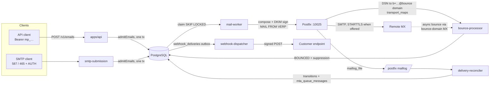

# System overview

MAIL_PLATFORM is a multi-tenant email service that delivers mail through infrastructure it operates itself: an outbound Postfix MTA, a bounce-receiving SMTP service and an authenticated submission gateway. No third-party sending provider is involved at any point.

This page describes the system **as implemented today**. For the recipient state machine see [MESSAGE-LIFECYCLE.md](MESSAGE-LIFECYCLE.md); for queueing and retry ownership see [QUEUE-DESIGN.md](QUEUE-DESIGN.md).

## Planes and processes

The spec's three logical planes map onto separately running processes. They share the PostgreSQL database (with role separation, see [TENANT-ISOLATION.md](TENANT-ISOLATION.md)) but never share a process: the HTTP API and SMTP delivery cannot take each other down.

| Plane | Process | Source | Role |
| --- | --- | --- | --- |
| Control | API | `apps/api` | Dashboard auth (sessions), API keys, domains + DNS verification, email admission, webhooks, suppressions, overview analytics. Fastify + OpenAPI 3.1. |
| Control | Dashboard | `apps/dashboard` | React SPA. Talks only to the API. |
| Control | Domain verifier | `services/domain-verifier` | Scheduled DNS re-verification and drift detection. |
| Delivery | SMTP submission | `services/smtp-submission` | Authenticated SMTP (STARTTLS / implicit TLS) → same admission path as the API. |
| Delivery | Mail worker (dispatcher) | `services/mail-worker` | Claims recipients, composes + DKIM-signs, hands each recipient to Postfix with a VERP envelope. Resolves uncertain hand-offs. |
| Delivery | Postfix | `infrastructure/postfix` | SMTP-to-MX transport, queueing, TLS, retries. Listens only on internal port 10025. |
| Delivery | Delivery reconciler | `services/delivery-reconciler` | Tails the Postfix log and converts delivery lines into recipient state transitions. Single consumer per log file. |
| Delivery | Bounce processor | `services/bounce-processor` | SMTP server for VERP return paths; parses RFC 3464 DSNs. |
| Delivery | Webhook dispatcher | `services/webhook-dispatcher` | Delivers signed events from the webhook outbox with retries and SSRF protection. |
| Observability | (in every process) | `packages/observability`, `packages/shared/src/logger.ts` | Prometheus metrics (prom-client), structured pino logs with redaction, `email_events` as the customer-visible event log. |

Shared libraries live in `packages/`: `core` (admission, transitions, domains, credentials, events), `mail-protocol` (addresses, headers, VERP, SMTP status classification, Postfix log and DSN parsing, MIME composition), `dns-verification`, `database` (Drizzle schema and clients), `contracts` (zod API schemas), `permissions`, `shared`, `observability`, `tokens`.

## Send path

1. **Admission.** The API (or SMTP gateway) validates the request, authorizes the From domain, enforces quotas and writes the email, its content, attachments, one row per recipient (state `QUEUED`, `SCHEDULED` or `SUPPRESSED`), the `email.accepted` event and any webhook deliveries in **one transaction**. A 202 response means the message is durable.
2. **Dispatch.** The mail worker claims due recipients, composes the RFC 5322 message once per email, signs it with the domain's DKIM key and submits it per recipient to Postfix with envelope sender `b+<recipient>-<mac>@<return-path domain>`. Postfix's `250 … queued as <id>` moves the recipient to `MTA_ACCEPTED`.
3. **Transport.** Postfix resolves MX records and delivers, retrying temporary failures on its own schedule.
4. **Outcome.** The reconciler reads Postfix log lines (`status=sent|deferred|bounced|expired`) and applies `REMOTE_ACCEPTED`, `DEFERRED`, `BOUNCED` or `FAILED`. DSNs (Postfix-generated or remote) reach the bounce processor; duplicates of an outcome already recorded are no-ops.
5. **Notification.** Every recorded event fans out to subscribed webhook endpoints through the outbox table; the dispatcher signs and delivers them.

## Processes and ports (local development)

All ports bind to `127.0.0.1` in development.

| Component | Port(s) | Metrics port | Source of setting |
| --- | --- | --- | --- |
| API | 3000 | 9100 | `API_PORT`, `METRICS_PORT` |
| Dashboard (Vite) | 5173 (proxies `/v1`, `/auth`, `/docs` to the API) | — | `apps/dashboard/vite.config.ts` |
| Mail worker | — | 9101 | `METRICS_PORT` |
| Delivery reconciler | — | 9102 | `METRICS_PORT` |
| Bounce processor | 2525 (SMTP) | 9103 | `BOUNCE_PORT` |
| Webhook dispatcher | — | 9104 | `METRICS_PORT` |
| Domain verifier | — | 9105 | `METRICS_PORT` |
| SMTP submission | 2587 (STARTTLS), 2465 (implicit TLS) in dev; defaults 587 / 465 | 9106 | `SMTP_STARTTLS_PORT`, `SMTP_IMPLICIT_TLS_PORT` |
| PostgreSQL | 5432 | — | `docker-compose.yml` |
| Redis | 6379 | — | `docker-compose.yml` |
| Postfix (internal hand-off) | 10025 | — | `docker-compose.yml` |
| Mailpit (captures all dev mail) | 8025 UI | — | `docker-compose.yml` |
| MX simulator (`*@mx-sim.test`) | 2525 inside the compose network | — | `infrastructure/docker/mx-simulator` |

Each metrics server also answers `/healthz`. The API additionally exposes `/healthz` and `/readyz` (database and Redis ping) and the public API reference at `/docs`.

### Development mail safety

In `docker-compose.yml` Postfix has `RELAYHOST=[mailpit]:1025`, so every message — including ones addressed to real domains such as gmail.com — is captured by Mailpit. Addresses at `mx-sim.test` are routed to the MX simulator, which accepts, defers, or rejects by local-part prefix (`accept*`, `defer*`, `unknown*`, `policy*`, `full*`, `datafail*`). VERP addresses are routed to the bounce processor via `transport_maps`. Nothing leaves the machine.

## Technology actually used

Node.js 24, TypeScript (strict), Fastify 5 with `fastify-type-provider-zod`, Drizzle ORM over `pg`, PostgreSQL 17, Redis 7 (rate limits and throttles only), Postfix 3.7 (Debian bookworm), nodemailer (composition, DKIM signing, MTA hand-off), smtp-server and mailparser (inbound SMTP), mailauth (SPF evaluation; DKIM verification in tests), undici (webhooks), prom-client, pino, React 18 + Vite + TanStack Query/Table + Tailwind mapped to design tokens.

## Not yet implemented

- Inbound email routing, marketing (contacts, segments, campaigns), templates, BIMI/VMC, billing, SSO/MFA/SCIM, IP pools and per-pool transports, complaint (ARF) ingestion.
- BullMQ is not used; see [ADR 0001](ADR/0001-postgres-outbox-queue.md).
- Object storage: attachments are stored base64 in PostgreSQL (`email_attachments.content_base64`).
- Kubernetes manifests, Terraform, Grafana dashboards, OpenTelemetry tracing. Production images exist (`infrastructure/docker/app.Dockerfile`) but no deployment manifests.
- Metrics servers bind to `127.0.0.1` by default (`startMetricsServer`), which Prometheus cannot scrape from outside a container; this needs a configurable bind address before production use.
