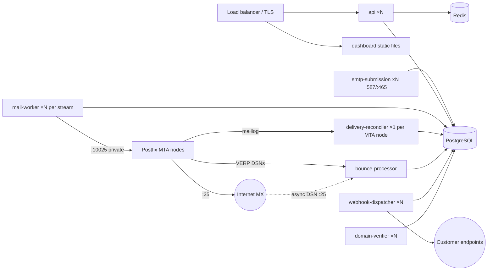

# Production deployment

**Status.** Images and configuration validation are production-ready in shape. **No Kubernetes, Terraform or Ansible manifests exist yet**, and the external prerequisites below are not in place. Don't open public sending until the checklist is complete.

## Process topology

* Scale API, mail-worker, webhook-dispatcher and domain-verifier horizontally. Their claims use `SKIP LOCKED` and leases.
* **delivery-reconciler: exactly one per Postfix log file**, running on or beside the MTA node with read access to its `maillog_file`. A single `worker_checkpoints` row named `postfix-log` exists today, so **several MTA nodes need a per-node checkpoint name. That isn't implemented** and blocks multi-node MTA deployments.
* Only the API (HTTPS), smtp-submission (587/465) and the bounce MX (25) face the public. Postgres, Redis, Postfix :10025 and metrics ports must stay private.

## Order of operations

1. Create the database roles `mp_owner` (migrations), `mp_app` (NOBYPASSRLS) and `mp_service` (BYPASSRLS).
2. Run the migrations image (`ENTRY=migrate`, `DATABASE_MIGRATION_URL` set to the owner role).
3. Deploy Postfix nodes, then the bounce processor and the reconcilers.
4. Deploy the workers, then the API, smtp-submission and the dashboard.

## Environment by process

Shared by all: `NODE_ENV=production`, `LOG_LEVEL`, `PLATFORM_NAME`.

| Variable | api | smtp-submission | mail-worker | reconciler | bounce-proc | webhooks | verifier |
|---|---|---|---|---|---|---|---|
| `DATABASE_URL` (mp_app) | ✔ | ✔ | | | | | |
| `DATABASE_SERVICE_URL` (mp_service) | ✔ | ✔ | ✔ | ✔ | ✔ | ✔ | ✔ |
| `REDIS_URL` | ✔ | ✔ | | | | | |
| `ENCRYPTION_KEYS` | ✔ | | ✔ | | | ✔ | |
| `VERP_SECRET` | ✔ | | ✔ | ✔ | ✔ | | |
| `PLATFORM_BOUNCE_DOMAIN`, `PLATFORM_BOUNCE_MX_HOST`, `PLATFORM_SPF_INCLUDE`, `PLATFORM_OUTBOUND_IPS` | ✔ | | ✔ | | | | ✔ |
| `MTA_HOST`, `MTA_PORT` | (✔ schema) | | ✔ | | | | (✔ schema) |
| Process-specific | `API_HOST`, `API_PORT`, `METRICS_PORT`, `PUBLIC_API_URL`, `DASHBOARD_ORIGIN`, `SESSION_TTL_HOURS`, `COOKIE_SECURE`(true), `ALLOW_PUBLIC_SIGNUP`, `DNS_SERVERS`, `RATE_LIMIT_PER_SECOND` | `SMTP_HOSTNAME`, `SMTP_BIND`, `SMTP_STARTTLS_PORT`, `SMTP_IMPLICIT_TLS_PORT`, `SMTP_TLS_KEY_FILE`*, `SMTP_TLS_CERT_FILE`*, `MAX_MESSAGE_BYTES`, `MAX_RECIPIENTS` | `WORKER_ID`, `WORKER_STREAMS`, `BATCH_SIZE`, `MTA_CONNECTIONS`, `LEASE_SECONDS`, `MAX_SUBMISSION_ATTEMPTS`, `RECONCILE_GRACE_SECONDS`, `POLL_INTERVAL_MS` | `POSTFIX_LOG_PATH`, `POLL_INTERVAL_MS` | `BOUNCE_HOST`, `BOUNCE_PORT`, `BOUNCE_HOSTNAME`, `MAX_MESSAGE_BYTES` | `POLL_INTERVAL_MS` | `DNS_SERVERS`, `POLL_INTERVAL_MS` |

\* Required in production. Each process also takes `METRICS_PORT` (defaults 9100–9106).

Refused at start-up when `NODE_ENV=production`: `DNS_FIXTURE_FILE`, `WEBHOOK_ALLOW_HTTP`, `WEBHOOK_ALLOW_PRIVATE_NETWORKS`, and `COOKIE_SECURE=false`.

## Prerequisites and blockers

- [ ] Static public IPs, PTR and forward DNS for every MTA node ([PTR-RDNS](../deliverability/PTR-RDNS.md))
- [ ] Outbound TCP/25 permitted by the provider
- [ ] Platform DNS: the SPF include record, the bounce MX host (A + MX target), API and SMTP hostnames
- [ ] TLS certificates for the API, SMTP submission and the bounce MX (no ACME automation yet)
- [ ] Secret manager holding `ENCRYPTION_KEYS`, `VERP_SECRET` and DB/Redis credentials (currently environment variables only; the `KeyProvider` interface is ready for a KMS implementation)
- [ ] Managed PostgreSQL with PITR backups ([BACKUP-RESTORE](BACKUP-RESTORE.md))
- [ ] Kubernetes manifests / Terraform / Ansible (not written)
- [ ] Metrics scraping, dashboards and alerting ([MONITORING](MONITORING.md); no dashboards yet)
- [ ] Log aggregation (Loki or equivalent; not configured)
- [ ] Per-node reconciler checkpoints for more than one MTA node (code change required)
- [ ] Signup email verification and an abuse review workflow ([ABUSE-PREVENTION](../security/ABUSE-PREVENTION.md)); keep `ALLOW_PUBLIC_SIGNUP=false` until then
- [ ] Legal review of privacy and retention ([PRIVACY](../security/PRIVACY.md))
