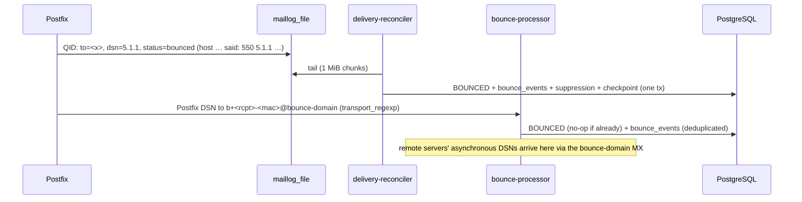

# DSN and bounce handling

**Purpose.** Describes how permanent and temporary delivery failures are detected, classified, deduplicated and turned into suppressions.

## Two sources

### 1. Postfix log (synchronous outcomes)

`services/delivery-reconciler` tails `POSTFIX_LOG_PATH`:

* `qmgr … from=<VERP>, … (queue active)` → decode the VERP and verify its HMAC → `mta_queue_messages(queue_id → recipient_id)`.
* `smtp … status=sent` → `REMOTE_ACCEPTED`.
* `status=deferred` → `DEFERRED`, carrying the classification.
* `status=bounced` → `BOUNCED`, a `bounce_events` row (source `postfix_log`), and a suppression when the bounce is hard.
* Per-recipient `status=expired`, or the queue-level `status=expired, returned to sender` → `FAILED` (`retry_expired`).

Each chunk of lines is applied in **one transaction together with the new file offset** (`worker_checkpoints`), so a crash can neither skip a line nor apply it twice. Rotation or truncation (a new file identity, or size smaller than the offset) restarts from offset 0. Event idempotency keys include `fileId:lineOffset`.

**Run exactly one reconciler per Postfix log file.**

### 2. DSN messages (asynchronous)

`services/bounce-processor` is an SMTP server (default `127.0.0.1:2525`):

* `RCPT TO` must be an authentic VERP address (HMAC-SHA256, 80-bit tag). Anything else gets `550 5.1.1`, so the processor is not a relay and forged bounces are rejected before any database access.
* The body is parsed with mailparser. Its `message/delivery-status` part is parsed by `parseDeliveryStatus` (RFC 3464: per-message fields, then per-recipient blocks, with folded lines unfolded).
* Without an RFC 3464 part, the processor falls back to extracting the first `NNN X.Y.Z` / `X.Y.Z` status from the subject and text.
* `Action: failed` → `BOUNCED`. This is also allowed from `REMOTE_ACCEPTED`, for asynchronous bounces, and the event data then carries `asynchronous: true`. `Action: delayed` → `DEFERRED` where that transition is legal. `delivered`/`relayed` are recorded nowhere.
* Message limit: 5 MiB. Up to 50 recipients per message.

## Deduplication

Postfix both logs a bounce and generates a DSN for it, so the same failure arrives twice. `bounce_events.dedupe_key = bounce:<recipient_id>:<enhanced status or code>` makes the second report a no-op, and the state transition is guarded, so `BOUNCED → BOUNCED` is impossible. The `email.bounced` event is deduplicated by `recipient:state:cause`.

## Classification (`classify()` in `packages/mail-protocol/src/smtp-status.ts`)

| Input | Class | Permanent | Suppress |
|---|---|---|---|
| 5.1.0, 5.1.1, 5.1.6, 5.1.10, 5.2.1 | `mailbox_unavailable` | yes | **yes** |
| 5.1.2, 5.4.1, 5.4.4 | `domain_invalid` | yes | **yes** |
| 5.1.3 | `recipient_rejected` | yes | **yes** |
| 5.2.2 | `mailbox_full` | yes | no |
| 5.2.3, 5.6.x | `content_rejected` | yes | no |
| 5.7.23, 5.7.25, 5.7.26, 5.7.27 | `authentication_rejected` | yes | no |
| other 5.7.x | `policy_rejected` | yes | no |
| 5xx with no enhanced code whose text matches "user unknown / no such user / does not exist …" | `mailbox_unavailable` | yes | **yes** |
| other 5xx | `recipient_rejected` | yes | no |
| 4xx text mentions greylist / "try again later" | `greylisted` | no | no |
| 4.2.2 | `mailbox_full` | no | no |
| 4.4.x | `temporary_network` | no | no |
| 4.7.4, 4.7.5 | `tls_failure` | no | no |
| other 4xx | `soft_bounce` | no | no |
| nothing parseable | `unknown` | no | no |

Policy, content and authentication rejections are **not** suppressed, because they say something about the sender, not the address. Suppressing on them would hide real problems.

## Suppression rule

A hard bounce (`suppress: true`) inserts `suppressions(org_id, address_lower, reason='hard_bounce')`, scoped to the tenant. The insert is idempotent: the original reason and timestamp are kept. See [SUPPRESSION](../deliverability/SUPPRESSION.md).

## Not built yet

* ARF / feedback-loop complaint ingestion (`message/feedback-report`). `suppression_reason='complaint'` exists in the schema, but nothing writes it yet.
* STARTTLS on the public bounce MX. The server runs with `hideSTARTTLS: true`, and certificates for the bounce host aren't wired up.
* Production exposure on port 25 of the bounce MX host (`PLATFORM_BOUNCE_MX_HOST`). It needs a public IP, a firewall rule and DNS.

## Verification

`tests/integration/delivery.test.ts`: a 550 5.1.1 becomes a hard bounce and a suppression; a policy rejection is not suppressed; the Postfix DSN path doesn't duplicate the bounce. Unit tests cover the DSN parser and the classification table.
