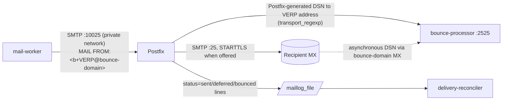

# Postfix architecture

**Purpose.** Postfix is the platform's outbound MTA. It owns SMTP-to-MX transport, the persistent mail queue, TLS to receivers and retries after a temporary failure. The application owns admission, policy, DKIM signing, customer-visible state and reconciliation. This page explains the image in `infrastructure/postfix/` setting by setting.

Related: [SMTP-TO-MX](SMTP-TO-MX.md) · [RETRY-SEMANTICS](RETRY-SEMANTICS.md) · [DSN-BOUNCE-HANDLING](DSN-BOUNCE-HANDLING.md) · [QUEUE-MANAGEMENT](QUEUE-MANAGEMENT.md)

## Position in the delivery plane



## Image

| File | Role |
|---|---|
| `Dockerfile` | `debian:bookworm-20250520-slim` + the distribution's `postfix` package (3.7.x; `postfix status` reports the running version), `ca-certificates`. Runs `postfix start-fg` as PID 1. |
| `main.cf` | Static baseline (below). |
| `master.cf` | Service table (below). |
| `entrypoint.sh` | Applies environment-specific values with `postconf -e`, writes `/etc/postfix/transport_regexp`, runs `postfix check`, then `exec postfix start-fg`. |

## `main.cf`, block by block

### Identity
```
myhostname = mta.mail-platform.test     # overridden by MTA_HOSTNAME
smtp_helo_name = $myhostname
```
In production `myhostname` must equal the PTR name of the node's outbound IP, and that name must resolve back to the same IP (forward-confirmed reverse DNS). See [PTR-RDNS](../deliverability/PTR-RDNS.md). It is not configured anywhere yet; it's a deployment prerequisite.

### No local delivery, no open relay
```
mydestination =
local_transport = error:5.1.1 local delivery is disabled
smtpd_client_restrictions   = permit_mynetworks, reject
smtpd_relay_restrictions    = permit_mynetworks, reject
smtpd_recipient_restrictions = permit_mynetworks, reject
disable_vrfy_command = yes
local_header_rewrite_clients =
always_add_missing_headers = no
```
Postfix accepts mail only from `mynetworks`, which `entrypoint.sh` sets to `127.0.0.0/8 $MTA_TRUSTED_NETWORKS`. It delivers nothing locally. It doesn't rewrite the headers the application composed, which would break the DKIM signature.

### Logging
```
maillog_file = /var/log/postfix/maillog
enable_long_queue_ids = yes
```
`postlogd` writes a syslog-format file that the [delivery reconciler](DSN-BOUNCE-HANDLING.md) tails. Long queue IDs are unique over time, so a queue ID never maps to two recipients. Timestamps have **one-second resolution** and no year. The parser infers the year and assumes UTC, which is the container default. `transitionRecipient` clamps event times so they stay monotonic per recipient.

### Routing
```
transport_maps   = regexp:/etc/postfix/transport_regexp
smtp_host_lookup = dns, native
```
`entrypoint.sh` generates `transport_regexp`:

```
/^b\+[a-z2-7]+-[a-z2-7]+@/   smtp:[$BOUNCE_PROCESSOR_HOST]:$BOUNCE_PROCESSOR_PORT
/@mx-sim\.test$/             smtp:[mx-simulator]:2525        # only when MX_SIMULATOR is set
```

* **VERP routing.** Any message addressed to a platform VERP address goes straight to the bounce processor, without a DNS lookup. In practice that's a non-delivery report Postfix itself generated for one of our envelopes.
* **MX simulator** (development and CI only). Recipients at `mx-sim.test` go to the scriptable simulator ([SMTP-TESTING](../testing/SMTP-TESTING.md)).
* `native` lookup lets `[host.docker.internal]` resolve through `/etc/hosts` in Docker Desktop.

Transport map entries with an explicit next hop take precedence over `relayhost`.

### Outbound TLS
```
smtp_tls_security_level = may
smtp_tls_CAfile = /etc/ssl/certs/ca-certificates.crt
smtp_tls_protocols = >=TLSv1.2
smtp_tls_mandatory_protocols = >=TLSv1.2
smtp_tls_loglevel = 1
smtp_tls_note_starttls_offer = yes
```
This is opportunistic TLS: Postfix uses STARTTLS when the receiver offers it and delivers in plaintext otherwise. MTA-STS, DANE and TLS-RPT are not configured; see [SMTP-TO-MX](SMTP-TO-MX.md).

### Retry ownership
```
maximal_queue_lifetime = 2d
bounce_queue_lifetime  = 1d
minimal_backoff_time   = 300s
maximal_backoff_time   = 4000s
queue_run_delay        = 300s
delay_warning_time     = 0h
```
After the application hands a message off (`MTA_ACCEPTED`), **only Postfix retries it**. No "delayed" warning DSNs are sent. Development overrides from `docker-compose.yml`:

| Variable | Effect | Compose value |
|---|---|---|
| `MAXIMAL_QUEUE_LIFETIME` | sets both queue lifetimes | `10m` |
| `MINIMAL_BACKOFF_TIME` | sets min/max backoff and `queue_run_delay` | `15s` |

### Limits
`message_size_limit = 41943040` (40 MiB, above the API's 10 MiB attachment limit to leave room for MIME overhead), `smtp_connect_timeout = 30s`, `smtp_helo_timeout = 60s`, `default_destination_concurrency_limit = 10`, `smtputf8_enable = yes`, `inet_protocols = ipv4`.

## `master.cf`

* **`10025 inet … smtpd`** is the only listener, carrying `syslog_name=postfix/internal` and the `permit_mynetworks,reject` restrictions. **There is no public port-25 `smtpd` on outbound nodes.** Inbound mail and asynchronous bounces belong to separate services.
* All services run with `chroot = n`, which keeps the container simple. `entrypoint.sh` still copies `resolv.conf`/`hosts` into the spool directory.
* `postlog unix-dgram … postlogd` is required for `maillog_file`.

## Environment (`entrypoint.sh`)

| Variable | Required | Meaning |
|---|---|---|
| `BOUNCE_PROCESSOR_HOST` | yes | Destination for VERP-addressed mail. |
| `BOUNCE_PROCESSOR_PORT` | no (2525) | |
| `MTA_HOSTNAME` | no | HELO name and `myhostname`. |
| `MTA_TRUSTED_NETWORKS` | no | CIDRs allowed to submit on :10025. Compose uses broad private ranges because Docker Desktop forwards published ports from a private gateway. **Narrow this to the application subnet in production.** |
| `RELAYHOST` | no | Smarthost. Set **only** in local or staging environments to capture mail (compose: `[mailpit]:1025`). |
| `MX_SIMULATOR` | no | `host:port`; enables `mx-sim.test` routing. Never set it in production. |
| `MAXIMAL_QUEUE_LIFETIME`, `MINIMAL_BACKOFF_TIME` | no | See above. |

## Security implications

* Port 10025 must be reachable only from mail-worker hosts. Compose publishes it on `127.0.0.1` only.
* A wrong `MTA_TRUSTED_NETWORKS` turns Postfix into an open relay for that network. Verify it with `postconf mynetworks` inside the container.
* The healthcheck runs `postfix status` every 10 seconds, which adds a `postfix-script` line to the log each time. The reconciler ignores those lines.

## Not built yet

These are blockers before production use:

* No multiple transports or `smtp_bind_address` per IP pool.
* No per-destination concurrency or rate policies.
* No Kubernetes or Ansible manifests for MTA nodes.
* No log rotation policy for `maillog_file`. The reconciler does handle rotation and truncation by resetting its offset.

## Verification

```sh
docker compose exec postfix postconf -n
docker compose exec postfix cat /etc/postfix/transport_regexp
docker compose exec postfix postfix status
tail -f .data/postfix-log/maillog
```
